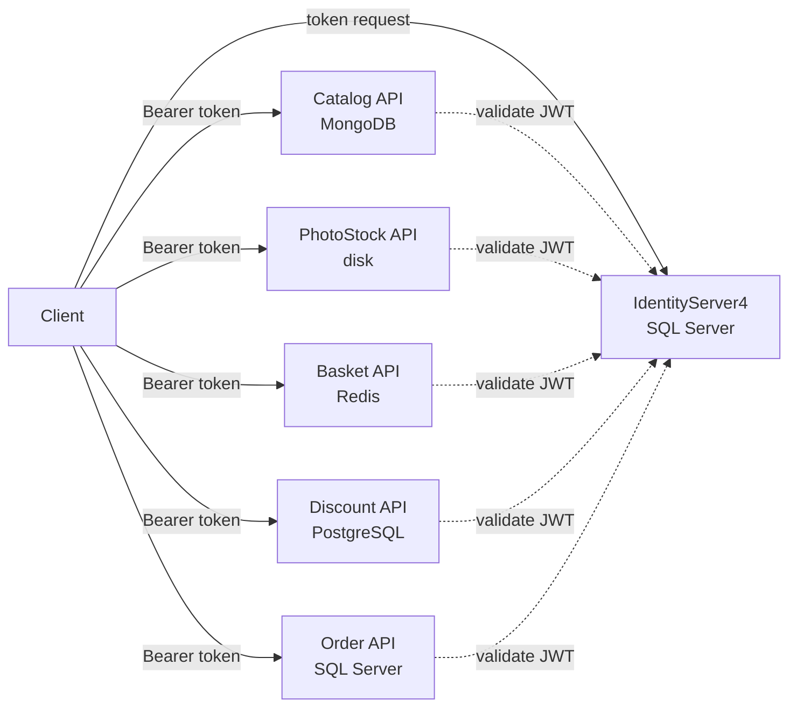

# MicroservicesCourseProject

Back-end microservices for an online course marketplace, secured with IdentityServer4 and each using its own data store.

> **📦 Archived** — this is a learning project from 2021, kept for reference. It is not maintained and is not production-ready.


## Overview

Users buy online courses: courses and categories live in a catalog, users keep a basket, apply discount codes, upload course photos and place orders. Every service validates JWT access tokens issued by a central IdentityServer, and each service owns a different database technology.

| Service | Port | Store | Responsibilities |
|---|---|---|---|
| IdentityServer | 5001 | SQL Server (ASP.NET Core Identity) | Token issuing (client credentials + resource owner password), user sign-up API |
| Catalog | 5011 | MongoDB | Courses and categories (CRUD) |
| PhotoStock | 5012 | Local disk (`wwwroot/photos`) | Upload / delete course photos |
| Basket | 5013 | Redis | Current user's basket |
| Discount | 5014 | PostgreSQL (Dapper) | Discount codes per user |
| Order | 5015 | SQL Server (EF Core) | Create orders and list the current user's orders (DDD + CQRS with MediatR) |

## Architecture



- Each API is a separate ASP.NET Core project with a global `AuthorizeFilter` and its own audience (`resource_catalog`, `resource_basket`, ...).
- `Course.Shared` contains the common `Response<T>` envelope, a base controller and `SharedIdentityService` (reads the user id from the `sub` claim).
- The Order service is split into Domain.Core / Domain / Application / Infrastructure / API layers; commands and queries are handled with MediatR and EF Core migrations are included.

## Tech stack

.NET 5 (services) · .NET Core 3.1 (IdentityServer, Shared) · IdentityServer4 4.0 · ASP.NET Core Identity · EF Core · MongoDB.Driver · StackExchange.Redis · Dapper + Npgsql · MediatR · AutoMapper · Swagger

## Project structure

```
MicroservicesCourseProject.sln
IdentityServer/CourseProject.IdentityServer/   # IdentityServer4 + ASP.NET Core Identity (EF migrations included)
Services/
├── Catalog/CourseServices.Catalog/
├── PhotoStock/FreeCourse.Services.PhotoStock/
├── Basket/CourseServices.Basket/
├── Discount/Course.Services.Discount/          # Scripts/TextFile.txt contains the table DDL
└── Order/                                      # API, Application, Domain, Domain.Core, Infrastructure
Shared/Course.Shared/
```

## Getting started

**Prerequisites**

- .NET 5 SDK (newer SDKs also build it). The services target `net5.0` and IdentityServer targets `netcoreapp3.1`; to run them without those runtimes installed, set `DOTNET_ROLL_FORWARD=Major`.
- Docker

```bash
docker run -d --name course-sql -e ACCEPT_EULA=Y -e 'MSSQL_SA_PASSWORD=Your_password123' \
  -p 1433:1433 mcr.microsoft.com/mssql/server:2022-latest
docker run -d --name course-mongo -p 27017:27017 mongo:6
docker run -d --name course-redis -p 6379:6379 redis:7
docker run -d --name course-postgres -e POSTGRES_USER=admin -e POSTGRES_PASSWORD=admin1234 \
  -e POSTGRES_DB=discountdb2 -p 5432:5432 postgres:16
```

- Create the `discount` table in PostgreSQL with the script in `Services/Discount/Course.Services.Discount/Scripts/TextFile.txt` (remove `Integrated Security=true` from the Discount connection string when using a password).
- IdentityServer applies its migrations and seeds a user on first start. The password grant looks users up by e-mail, so log in with `username=gokhanertogan` (the seeded e-mail value) and `password=Password12*`.
- Order API defaults to SQL Server LocalDB; elsewhere override it, e.g. `export ConnectionStrings__DefaultConnection='Server=localhost,1433;Database=OrderDb2;User Id=sa;Password=Your_password123;TrustServerCertificate=True'`, and apply its migrations (`dotnet ef database update -p Services/Order/Course.Services.Order.Infrastructure -s Services/Order/Course.Services.Order.API`).

```bash
dotnet run --project IdentityServer/CourseProject.IdentityServer
dotnet run --project Services/Catalog/CourseServices.Catalog
# ...same for the other services
```

Get a user token from `http://localhost:5001/connect/token` with `grant_type=password`, `client_id=WebMvcClientForUser`, `client_secret=secret`, then call the APIs with `Authorization: Bearer <token>`.

## Notes / limitations

- There is no API gateway, web client or messaging between services; checkout does not yet flow from basket to order.
- Client secrets, the developer signing key and database passwords are local demo values.
- .NET 5 and .NET Core 3.1 are out of support; the projects are kept on their original target frameworks.
